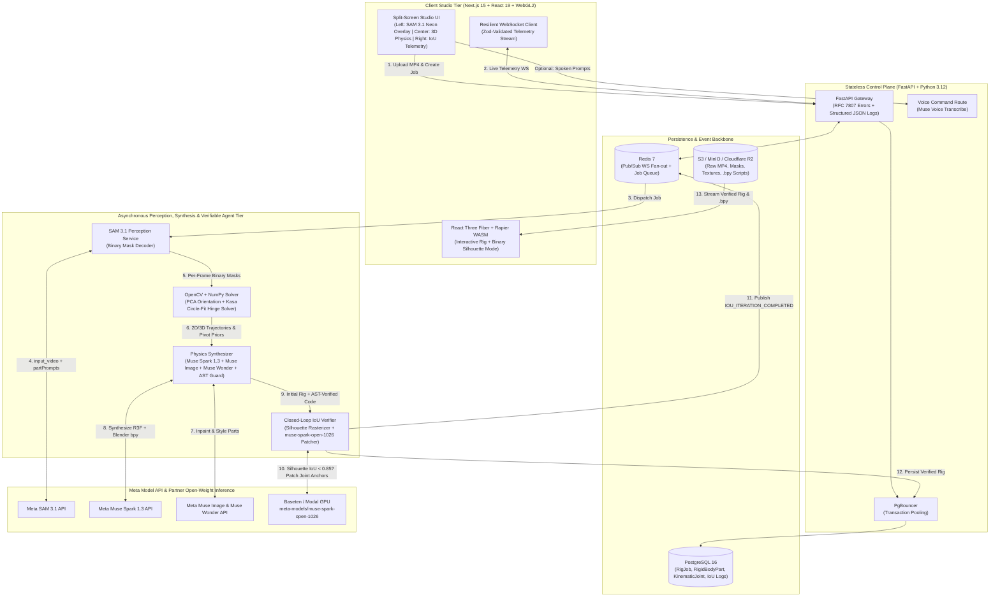

<div align="center">

# ⚡ ChronoRig

### Autonomous Video-to-Physics 3D Rigging & Closed-Loop Simulation Engine
**Built for the Meta Global AI Developer Hackathon (Oct 26 – Nov 4, 2026)**

[](https://dev.meta.ai/events/global-hackathon)
[](https://dev.meta.ai/events/global-hackathon)
[](https://dev.meta.ai/docs/models)
[](./LICENSE)

</div>

---

## 🏆 Hackathon Submission Overview (For Judges)

| Submission Attribute | Details |
| :--- | :--- |
| **Competition Track** | **Track 1: Indie Developer Track** (Solo Builder: **Mohit Manoj Prasad**) |
| **Problem Statement** | **Theme 2: Push the Frontier** — *Unlocking a verifiable way for machines to perceive, rig, and simulate physical mechanisms from standard video.* |
| **New Work Declaration** | **100% built from scratch during the official Hackathon window (Oct 26 – Nov 4, 2026).** Every line of backend perception math, agent orchestration, and 3D WebGL physics studio code was authored during this event. |
| **Bonus Prize Qualifications** | 1. **Best Build on Meta Open Weight Models ($10K):** Uses `meta-models/muse-spark-open-1026` (via Baseten 2M TPM / Modal GPU) for high-frequency iterative joint-anchor patching.<br>2. **Best Agentic Use-Case ($5K):** Implements a **Closed-Loop Verifiable Physics Agent** that renders synthetic 3D silhouettes, computes pixel Intersection-over-Union ($\text{IoU}$) against `SAM 3.1` ground-truth masks, and self-debugs physics code until $\text{IoU} \ge 0.85$.<br>3. **Best Creative Build ($5K):** Pairs `Muse Image` (orthographic occlusion inpainting) with `Muse Wonder` (generative PBR shader synthesis). |

---

## 🎯 The Problem & Why ChronoRig Matters

Creating articulated, physics-accurate 3D assets (for robotics simulation, digital twins, game engines, and VFX) is a slow manual bottleneck. Photogrammetry and Gaussian Splatting capture **static geometry**, but they fail when an object has **moving joints, hinges, sliders, and mass constraints**—producing "frozen" meshes that cannot be actuated.

**ChronoRig solves the physical-to-digital kinematics gap:**
1. Record a **5-to-10 second smartphone video** of any articulated physical mechanism moving (an articulated desk lamp, a robotic gripper, a scissor linkage, or a mechanical suspension arm) and optionally speak what you want tracked via **Muse Voice Transcribe**.
2. **SAM 3.1** isolates every moving component with pixel-accurate binary raster masks and stable object IDs across video frames.
3. ChronoRig's deterministic **OpenCV PCA + Algebraic Kasa Circle-Fit Solver** extracts 2D/3D centroid trajectories, principal orientation angles ($\theta_t$), and exact hinge/slider pivot coordinates.
4. **Muse Image** & **Muse Wonder** reconstruct unoccluded orthographic textures and PBR surface descriptors for each rigid body.
5. **Muse Spark 1.3** (`reasoning_effort: "max"`) + **Muse Code** synthesize executable **React Three Fiber + Rapier WASM** 3D physics rigs and exportable **Blender 4.x (`bpy`)** Python scripts.
6. **The Verifiable Agent Loop (`meta-models/muse-spark-open-1026`):** ChronoRig renders synthetic binary silhouettes of the simulated 3D rig at keyframes, calculates pixel $\text{IoU}$ against `SAM 3.1`'s ground-truth masks, and autonomously patches joint anchors until the simulated physics match reality.

---

## 🧠 Deep Integration of Meta AI Tooling

ChronoRig is architected specifically around the multi-model capabilities of the **Meta Model API** and **Meta Open-Weight Models**:

| Meta Model / Tool | Model ID / SDK | Exact Engineering Role in ChronoRig |
| :--- | :--- | :--- |
| **SAM 3.1** | `sam-3.1` (`POST /v1/responses`) | Zero-shot spatiotemporal video segmentation. Streams `input_video` + noun-phrase part prompts and decodes per-frame binary raster masks with persistent object IDs. |
| **Muse Spark 1.3** | `muse-spark-1.3` (`reasoning_effort: "max"`) | 1M-context multimodal physics architect. Ingests kinematic trajectory JSON + keyframe imagery to infer joint topologies (`revolute`, `prismatic`, `spherical`, `fixed`), mass ratios, and initial `@react-three/rapier` + Blender `bpy` scripts. |
| **Muse Spark Open** | `meta-models/muse-spark-open-1026` (Baseten / Modal) | High-speed **Closed-Loop Verifiable Agent**. Analyzes frame-by-frame silhouette $\text{IoU}$ residuals after each simulation pass and outputs deterministic JSON patches to refine 3D joint anchor offsets (`anchorWorldXyz`) and damping limits. |
| **Muse Code** | `@muse-code/sdk` | Programmatic headless coding agent runtime used to validate, patch, and hot-reload generated TypeScript/Python physics scenes in isolated sandboxes. |
| **Muse Image** | `muse-image` | Instruction-guided orthographic texture reconstruction. In-paints regions occluded by overlapping mechanical arms during motion. |
| **Muse Wonder** | `muse-wonder` | Generative PBR material and shader synthesis for stylized and photorealistic 3D viewport rendering. |
| **Muse Voice Transcribe** | `muse-voice-transcribe` | Hands-free workbench voice interface (`POST /api/v1/jobs/{id}/voice-command`) that converts spoken instructions into structured `SAM 3.1` segmentation prompts. |

---

## 🏗️ System Architecture



---

## 📐 Mathematical Foundation

ChronoRig does not ask an LLM to "guess" physics from raw pixels. Instead, it pairs `SAM 3.1`'s pixel-accurate segmentation with deterministic linear algebra and a closed-loop verification metric:

### 1. Principal Component Analysis (PCA) Part Orientation ($\theta_t$)
For each binary raster mask $M_{k,t} \in \{0, 1\}^{H \times W}$ of object $k$ at frame $t$, we extract foreground pixel coordinates $\mathbf{P} = \{(x_i, y_i)\}_{i=1}^{N}$ and compute the $2 \times 2$ covariance matrix:

$$\Sigma = \frac{1}{N - 1} \sum_{i=1}^{N} (\mathbf{p}_i - \boldsymbol{\mu})(\mathbf{p}_i - \boldsymbol{\mu})^{\top}, \quad \text{where } \boldsymbol{\mu} = (\bar{x}, \bar{y})$$

From the principal eigenvector $\mathbf{v}_1 = [v_{1,x}, v_{1,y}]^{\top}$ associated with the largest eigenvalue $\lambda_1$, we recover the instantaneous orientation angle $\theta_t$ and mask eccentricity $\epsilon$:

$$\theta_t = \operatorname{atan2}(v_{1,y}, v_{1,x}), \quad \epsilon = 1 - \frac{\lambda_2}{\lambda_1}$$

### 2. Algebraic Kasa Circle-Fit for Revolute Joint Pivots
Given a child rigid body's centroid sequence $\{(x_t, y_t)\}_{t=0}^{T}$ rotating relative to a parent body with angular span $\Delta \theta_{\max} \ge 0.08\text{ rad}$, we solve the overdetermined linear least-squares system for the hinge center $(c_x, c_y)$:

$$\begin{bmatrix} 2x_0 & 2y_0 & 1 \\ \vdots & \vdots & \vdots \\ 2x_T & 2y_T & 1 \end{bmatrix} \begin{bmatrix} c_x \\ c_y \\ R^2 - c_x^2 - c_y^2 \end{bmatrix} \approx \begin{bmatrix} x_0^2 + y_0^2 \\ \vdots \\ x_T^2 + y_T^2 \end{bmatrix}$$

If the trajectory is collinear ($\operatorname{rank}(\mathbf{A}) < 2$), the solver classifies the constraint as a **prismatic slider**; if $\Delta \theta_{\max} < 0.08\text{ rad}$, it classifies the joint as **fixed**.

### 3. Closed-Loop Silhouette Intersection-over-Union ($\text{IoU}$) Verification
At evaluation keyframes $t \in \{0, 30, 60\}$, ChronoRig compares the union of `SAM 3.1` ground-truth masks $M_{\text{SAM}}^{(t)}$ against the rendered 3D physics silhouette $M_{\text{Sim}}^{(t)}$:

$$\text{IoU}(t) = \frac{\left\vert{} M_{\text{SAM}}^{(t)} \cap M_{\text{Sim}}^{(t)} \right\vert{}}{\left\vert{} M_{\text{SAM}}^{(t)} \cup M_{\text{Sim}}^{(t)} \right\vert{}}$$

Whenever $\overline{\text{IoU}} < 0.85$, `meta-models/muse-spark-open-1026` inspects the per-frame $\text{IoU}$ breakdown and patches the 3D joint anchor offsets until convergence.

---

## 🌍 Real-World Use Cases

* **Robotics Sim-to-Real & URDF/Blender Bootstrapping:** Record a physical robotic gripper or linkage on a workbench and export an articulated Blender (`bpy`) or Three.js scene with calibrated joint limits in under 30 seconds.
* **Interactive Game Dev & VFX Asset Rigging:** Turn real-world props (doors, chests, mechanical traps, lamps, pendulums) into interactive WebGL (`@react-three/rapier`) physics objects you can grab and actuate immediately.
* **Industrial Mechanism Diagnostics:** Visually track angular velocity curves ($\omega_t$) and pivot drift on physical machinery directly from standard video feeds.

---

## 📂 Monorepo Directory Structure

```text
chronorig/
├── apps/
│   ├── web/                              # Next.js 15 + React 19 + R3F + Rapier 3D Studio
│   │   ├── src/
│   │   │   ├── app/studio/[jobId]/       # 12-Column Split-Screen Studio Page
│   │   │   ├── components/
│   │   │   │   ├── canvas/               # PhysicsRigViewport.tsx (Rapier + Silhouette Mode)
│   │   │   │   ├── overlay/              # SamMaskOverlayCanvas.tsx (2D Masks + PCA Vectors)
│   │   │   │   └── telemetry/            # TelemetryPanel.tsx (Live IoU Chart & Muse Diffs)
│   │   │   ├── hooks/                    # useRigWebSocket.ts (Resilient WS + Zod validation)
│   │   │   └── store/                    # useRigStore.ts (Zustand state machine)
│   │   └── tests/                        # Vitest frontend unit & contract tests
│   └── api/                              # FastAPI Control Plane + AI/CV Worker Engine
│       ├── migrations/versions/          # Reversible SQL up/down schema migrations
│       ├── src/
│       │   ├── core/                     # Fail-fast Pydantic config, RFC 7807 errors, JSON logs
│       │   ├── models/                   # SQLAlchemy 2.0 ORM models (RigJob, KinematicJoint)
│       │   ├── modules/
│       │   │   ├── perception/           # SAM 3.1 client, Muse Voice, OpenCV PCA & Hinge solver
│       │   │   ├── synthesis/            # Muse Spark 1.3, Muse Image/Wonder, AST security guard
│       │   │   └── verification/         # Closed-Loop Silhouette IoU Verifiable Agent
│       │   └── main.py                   # FastAPI entrypoint & Redis Pub/Sub WebSocket stream
│       └── tests/                        # PyTest suite (>85% coverage on kinematic math & IoU)
├── packages/
│   └── contracts/                        # Shared TypeScript & Zod Schemas + OpenAPI 3.1 Spec
├── infra/
│   └── docker/                           # Docker Compose (Postgres 16, PgBouncer, Redis 7, MinIO)
├── .env.example
└── README.md
```

---

## 🚀 Quickstart & Local Setup

### Prerequisites
* **Python 3.12+** & [`uv`](https://github.com/astral-sh/uv)
* **Node.js 22+** & `pnpm`
* **Docker & Docker Compose** (for PostgreSQL 16, PgBouncer, Redis 7, and MinIO S3)
* API Keys: `META_MODEL_API_KEY` (from [dev.meta.ai](https://dev.meta.ai)) and `BASETEN_API_KEY` (for `meta-models/muse-spark-open-1026`)

### 1. Clone & Configure Environment
```bash
git clone [https://github.com/mhtpsd/ChronoRig.git](https://github.com/mhtpsd/ChronoRig.git)
cd ChronoRig
cp .env.example .env
# Edit .env and add your META_MODEL_API_KEY and BASETEN_API_KEY
```

### 2. Start Infrastructure Services (PostgreSQL, Redis, MinIO)
```bash
docker compose -f infra/docker/docker-compose.yml up -d
```

### 3. Run the FastAPI Backend & Run PyTest Guardrails
```bash
cd apps/api
uv sync
uv run pytest -v
uv run uvicorn src.main:app --reload --host 0.0.0.0 --port 8000
```

### 4. Launch the Next.js 15 Split-Screen 3D Studio
```bash
cd apps/web
pnpm install
pnpm test
pnpm dev
```
Open **[http://localhost:3000/studio/11111111-2222-4333-8444-555555555555](http://localhost:3000/studio/11111111-2222-4333-8444-555555555555)** in your browser to interact with the 3D physics rig, toggle **PCA $\theta$ Vectors** and **Binary Silhouette Mode**, and inspect the live **IoU Convergence Curve**.

---

## 🛡️ Production Security & Reliability Guardrails

* **AST Static Sandbox for Generated Blender (`bpy`) Code:** Every Python script synthesized by `Muse Spark 1.3` / `Muse Code` is parsed via Python's `ast` module before storage or execution, strictly rejecting dangerous imports (`os`, `subprocess`, `socket`, `urllib`, `http`, `sys`) and dynamic builtins (`eval`, `exec`, `open`).
* **Zero-Explosion Frame-0 Collision Filtering:** Directly jointed parent-child rigid bodies are placed into non-colliding Rapier `interactionGroups` so slight bounding-box overlaps on Frame 0 never trigger physics explosions.
* **RFC 7807 Problem Details & PII-Redacted JSON Logging:** Every FastAPI route emits structured single-line JSON logs with `X-Request-ID` trace correlation and recursive secret sanitization.
* **Fail-Fast Startup Validation:** Both the Python backend (`pydantic-settings`) and Next.js frontend (`zod`) validate all required environment variables at boot and refuse to start if misconfigured.

---

## 👤 Author

**Mohit Manoj Prasad**  
*Software Engineer — Backend, Distributed Systems & Multimodal AI*  
* GitHub: [@mhtpsd](https://github.com/mhtpsd)